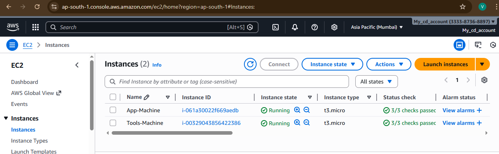
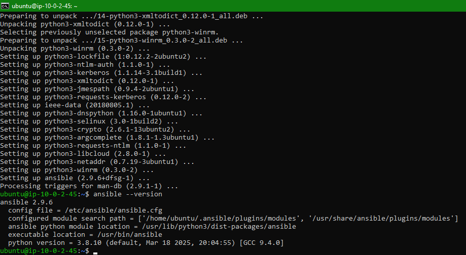
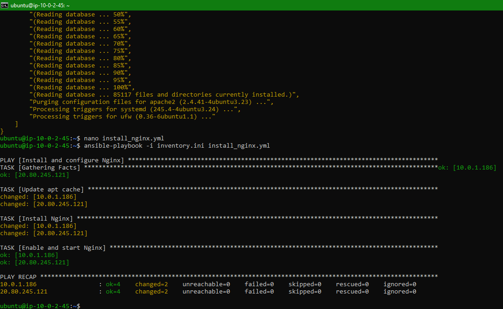
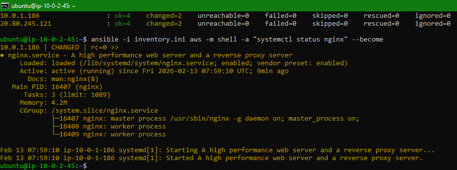
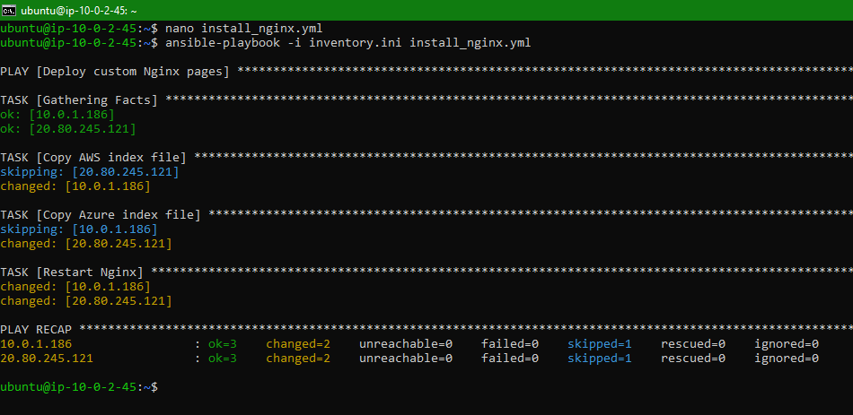
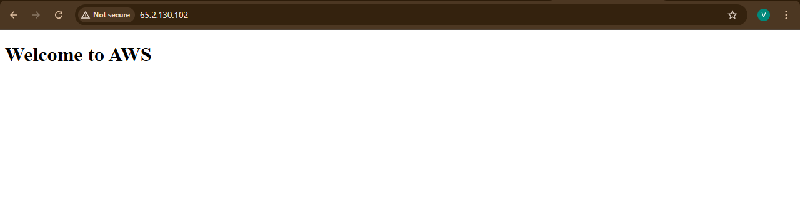
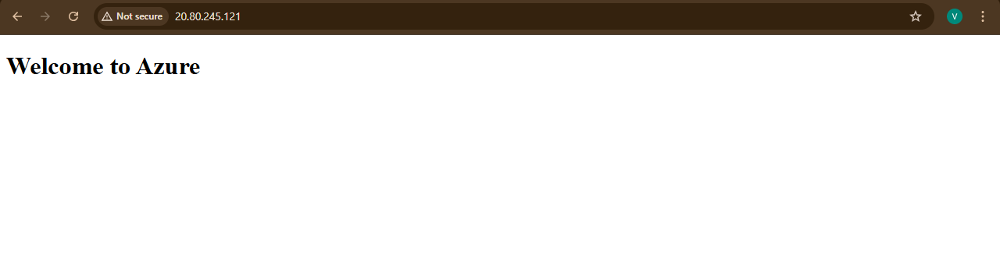

# AWS & Azure Multi-Cloud CI/CD Platform

## Project Overview

This repository showcases an end-to-end **Multi-Cloud DevOps**
implementation across **Amazon Web Services (AWS)** and **Microsoft
Azure**. The project demonstrates Infrastructure as Code (IaC),
Configuration Management, Continuous Integration/Continuous Deployment
(CI/CD), web server deployment, and disaster recovery using Terraform,
Ansible, Jenkins, Nginx, Route 53, and cloud infrastructure.

The implementation covers five major tasks: 1. Infrastructure
Provisioning using Terraform 2. Configuration Management using Ansible
3. Application Deployment 4. Jenkins CI/CD Pipeline 5. Route 53 DNS
Failover & Disaster Recovery

> **Note:** Cloud resources were terminated after project validation to
> avoid unnecessary costs. The screenshots document the completed
> implementation.

------------------------------------------------------------------------

# Architecture Overview

    Terraform
        ↓
    AWS + Azure Infrastructure
        ↓
    Ansible Configuration
        ↓
    Nginx Deployment
        ↓
    Jenkins CI/CD Pipeline
        ↓
    Route 53 Health Checks
        ↓
    Automatic DNS Failover

------------------------------------------------------------------------

# Technologies Used

-   AWS
-   Microsoft Azure
-   Terraform
-   Ansible
-   Jenkins
-   Nginx
-   Ubuntu Linux
-   Git
-   GitHub

------------------------------------------------------------------------

# Project Tasks

## Task 1 -- Infrastructure Provisioning

-   Provisioned AWS and Azure infrastructure using Terraform.
-   Created networking, compute resources, and validated SSH
    connectivity.
### Terraform Plan


### Terraform Apply Output


### AWS Infrastructure



## Task 2 -- Configuration Management

-   Installed and configured Ansible.
-   Configured inventory and automated Nginx installation.
-   Validated deployments on AWS and Azure.
### Ansible Installation



### Nginx Playbook Execution



### AWS Nginx Verification



## Task 3 -- Application Deployment

-   Deployed web application using Ansible.
-   Configured Nginx and verified browser access.
### Ansible Deployment Logs



### AWS Application Output



### Azure Application Output



## Task 4 -- Jenkins CI/CD Pipeline

-   Configured Jenkins pipeline.
-   Executed automated deployment successfully.
-   Screenshots: `screenshots/subtask-4/`

## Task 5 -- Route 53 Failover & Disaster Recovery

-   Configured Route 53 hosted zone and failover records.
-   Implemented health checks and validated automatic failover.
-   Screenshots: `screenshots/subtask-5/`

------------------------------------------------------------------------

# Repository Structure

``` text
multi-cloud-ci-cd-platform/
├── README.md
└── screenshots/
    ├── subtask-1/
    ├── subtask-2/
    ├── subtask-3/
    ├── subtask-4/
    └── subtask-5/
```

------------------------------------------------------------------------

# Skills Demonstrated

-   AWS
-   Azure
-   Terraform
-   Infrastructure as Code (IaC)
-   Ansible
-   Jenkins
-   CI/CD
-   Nginx
-   Linux
-   Git & GitHub
-   Route 53
-   Disaster Recovery

------------------------------------------------------------------------

# Learning Outcomes

-   Infrastructure Automation
-   Multi-Cloud Deployment
-   Configuration Management
-   Continuous Integration & Deployment
-   Linux Administration
-   DNS Failover
-   End-to-End DevOps Workflow

------------------------------------------------------------------------

# Note

AWS and Azure resources were deleted after successful project validation
to avoid unnecessary cloud costs. The screenshots included in this
repository demonstrate the successful completion of every implementation
stage.
